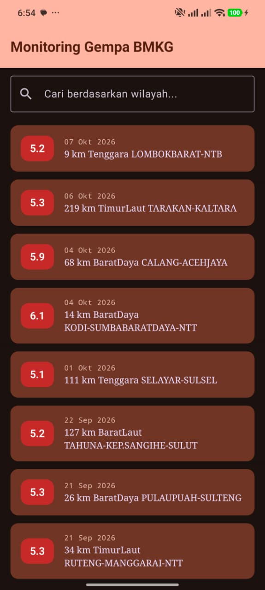
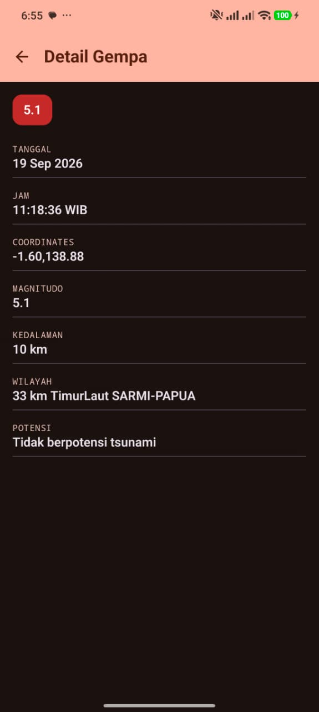

# Aplikasi Katalog & Monitoring Gempa BMKG

Aplikasi Android (Kotlin + Jetpack Compose) untuk melihat daftar gempa terkini dari BMKG.

## Screenshot

<table>
  <tr>
    <th>Home</th>
    <th>Detail</th>
  </tr>
  <tr>
    <td></td>
    <td></td>
  </tr>
</table>
## Fitur
- Daftar gempa terkini (LazyColumn): tanggal, magnitudo, wilayah
- Pencarian lokal berdasarkan wilayah
- Loading state, error state + tombol coba lagi, empty state
- Halaman detail: tanggal, jam, coordinates, magnitudo, kedalaman, wilayah, potensi
- Material Design 3 dengan tema Light/Dark kustom

## Arsitektur (MVVM)
View (Composable) → ViewModel (StateFlow<UiState>) → Repository → Retrofit API Service → BMKG API

- `UiState`: sealed interface `Loading | Success | Error`
- Composable tidak memanggil API langsung

## API
- Base URL: `https://data.bmkg.go.id`
- Endpoint: `/DataMKG/TEWS/gempaterkini.json`
- Struktur: `Infogempa.gempa[]`

## Teknis
- Kotlin, Jetpack Compose, Material 3
- Retrofit + converter-gson, navigation-compose, lifecycle-viewmodel-compose
- Min SDK: (isi), Target SDK: (isi)

## Cara Menjalankan
1. Clone repo, buka di Android Studio
2. Sync Gradle, jalankan di emulator/perangkat
3. APK debug: `app/build/outputs/apk/debug/app-debug.apk`